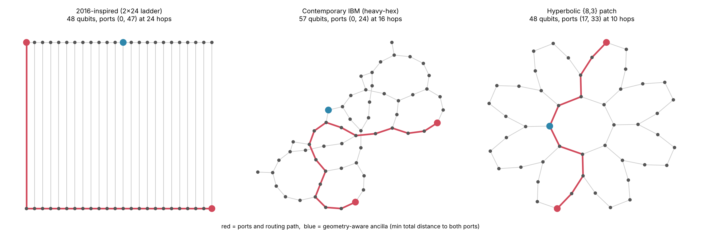
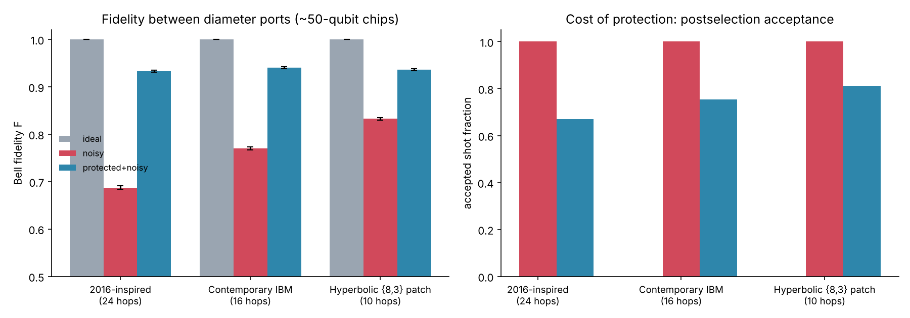
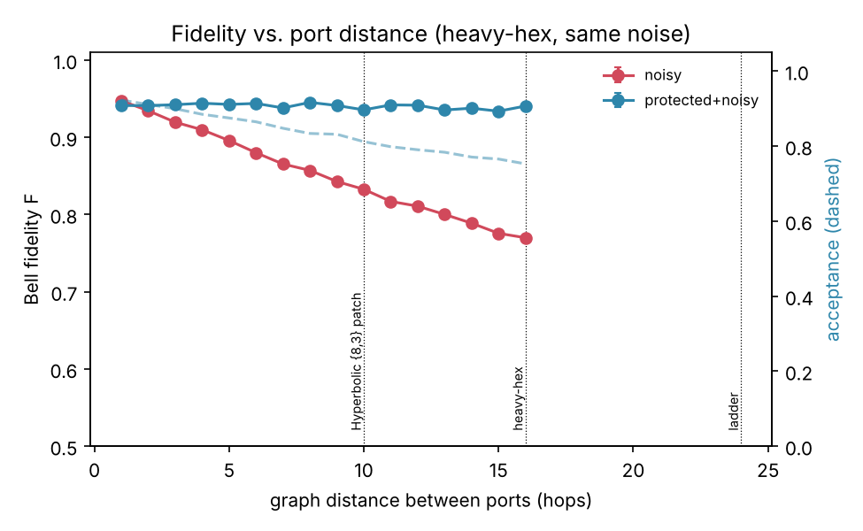

# GeoBell: geometry-aware Bell pairs across processor graphs

**WQCC Qiskit Fall Fest 2026, quanTA / USask prompt: "How does processor geometry affect entanglement?"**

I create a Bell pair between two fixed **port** qubits at opposite ends of three ~50-qubit processor graphs. For each graph I compare an **ideal**, a **noisy**, and a **protected + noisy** run, then measure what protection costs. Everything is built and simulated in Qiskit + Qiskit Aer.



## Where Qiskit fits
- `CouplingMap` (including `CouplingMap.from_heavy_hex`) defines the processor graphs.
- `transpile` with a fixed `initial_layout` handles routing. I compile twice: once with `swap` kept as a gate so SWAPs can be counted, then lowered to `cx` + Clifford 1q gates.
- `qiskit_aer.noise.NoiseModel` is my own noise model (option 1 on the prompt slide).
- `AerSimulator(method="stabilizer")` runs the circuits. They are fully Clifford and the noise is Pauli, so even 25-qubit routes simulate fast.
- Mid-circuit measurement and `reset` are used for the syndrome checks.

## The three geometries (similar size, so geometry is the only variable)
| Model | Graph | Qubits | Port distance (diameter) |
|---|---|---|---|
| 2016-inspired | 2×N ladder (the layout style of IBM QX5, 2×8), scaled to 2×24 | 48 | 24 hops |
| Contemporary IBM | heavy-hex, code distance 5 | 57 | 16 hops |
| Hyperbolic | two-ring patch of the {8,3} tiling (octagons, three per vertex; 3×135° = 405° > 360° gives negative curvature) | 48 | 10 hops |

## Protocol
1. **Bell pair:** `H(A); CX(A,B)`. The transpiler routes the CX across the chip with SWAPs.
2. **Protection (syndrome postselection with a geometry-aware ancilla).** |Φ⁺⟩ is the +1 eigenstate of both **ZZ** and **XX**, and these commute. One ancilla measures ZZ (catches bit flips), is reset, then measures XX (catches phase flips). Any single-qubit X, Y or Z error on a port flips at least one syndrome. I keep only shots where both syndromes read 0.
   The ancilla is placed on the physical qubit that minimises `dist(anc, A) + dist(anc, B)`, with ties broken toward the midpoint, so the check costs as little extra routing as the geometry allows.
3. **Fidelity (as specified in the prompt):** measure the ports in ZZ, XX and YY; ⟨PP⟩ = (agree − disagree)/shots; **F = [1 + ⟨XX⟩ − ⟨YY⟩ + ⟨ZZ⟩]/4**, using accepted shots only when postselecting. The ± is the propagated binomial standard error, √(Σ(1−⟨PP⟩²)/N)/4.

**Noise model** (identical on every graph): depolarizing 0.1% on 1q gates, 1% on CX, 1.5% symmetric readout error. 8000 shots per basis, fixed seeds.

## Results
| Model | Case | F ± σ | Depth | 2q gates | SWAPs | Physical qubits | Accepted |
|---|---|---|---|---|---|---|---|
| 2016 ladder | ideal | 1.0000 | 42 | 70 | 23 | 25 | 1.00 |
| 2016 ladder | noisy | 0.687 ± 0.004 | 42 | 70 | 23 | 25 | 1.00 |
| 2016 ladder | protected | **0.933 ± 0.002** | 48 | 75 | 24 | 25 (incl. 1 ancilla) | 0.67 |
| Heavy-hex | ideal | 1.0000 | 30 | 46 | 15 | 17 | 1.00 |
| Heavy-hex | noisy | 0.770 ± 0.004 | 30 | 46 | 15 | 17 | 1.00 |
| Heavy-hex | protected | **0.941 ± 0.002** | 36 | 51 | 16 | 17 (incl. 1 ancilla) | 0.75 |
| Hyperbolic {8,3} | ideal | 1.0000 | 18 | 28 | 9 | 11 | 1.00 |
| Hyperbolic {8,3} | noisy | 0.832 ± 0.003 | 18 | 28 | 9 | 11 | 1.00 |
| Hyperbolic {8,3} | protected | **0.936 ± 0.002** | 27 | 33 | 10 | 11 (incl. 1 ancilla) | 0.81 |

The 2q-gate count is CX after lowering (each SWAP = 3 CX). Physical qubits = qubits the routed circuit actually touches. Full numbers are in `results.json`.




## What I learned
- **Geometry enters through hop distance.** On a fixed noise model, unprotected fidelity falls roughly linearly with the number of SWAPs (sweep plot). Each graph's result lands on that same curve at its own diameter.
- **Hyperbolic graphs keep ports close.** Distance in a hyperbolic lattice grows logarithmically with size, versus linearly for a ladder and as √N for planar heavy-hex. At ~50 qubits the {8,3} patch has the smallest diameter (10 vs 16 vs 24), so it has the best raw Bell pair (0.83 vs 0.77 vs 0.69), with less than half the ladder's depth and CX count.
- **Postselection flattens geometry, but you pay in shots.** With ZZ+XX checks, all three chips reach F ≈ 0.93–0.94. The cost is acceptance: 81% (hyperbolic), 75% (heavy-hex), 67% (ladder). In other words, the ladder spends ~1.5× more shots per good Bell pair than the hyperbolic chip. Geometry moves from a *fidelity* cost to a *sampling* cost.
- **What the checks can't catch:** errors after the check (final basis change, readout) and correlated errors that flip both ports together. These cap protected F near 0.94 regardless of distance.

## Limitations and next steps
- Noise is uniform depolarizing. Next I'd re-run with `FakeBrisbane`/`FakeSherbrooke` calibrations, with idle/thermal-relaxation noise during SWAP chains, and on real IBM hardware for the heavy-hex case.
- The hyperbolic patch is small (two rings) and still has boundary effects.
- Only one round of checks. Repeated checks, or placing check ancillas along the path (catching errors mid-route), plus readout mitigation on the ports, are the obvious upgrades.
- A "generate in the middle, swap outward" Bell strategy would roughly halve the time each half of the pair spends in transit and is worth comparing.

## Run it
```bash
pip install -r requirements.txt
python geobell.py     # runs all 9 cases + the distance sweep, writes results.json (~1–2 min)
python plots.py       # writes the three figures
```

Author: Aarush (UW–Madison) · github.com/aarushkampani8888-hash
